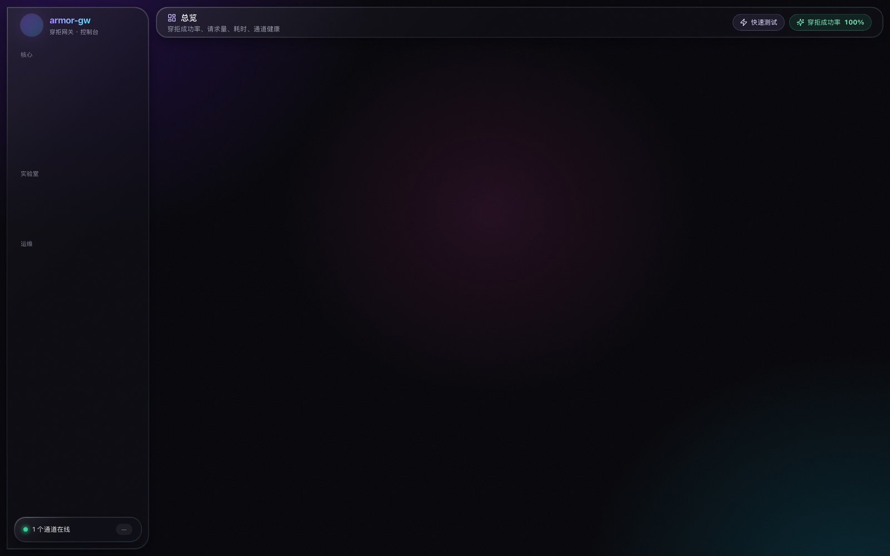
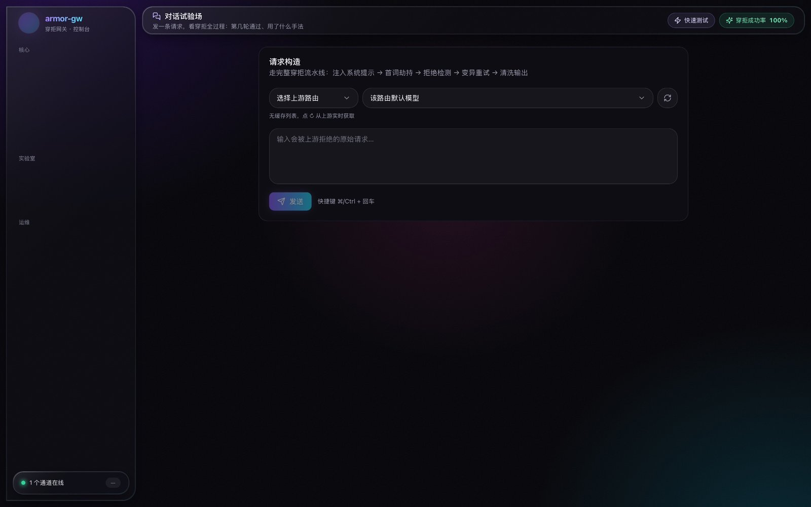

<div align="center">

# armor-gw

**LLM request gateway — retries refused answers until you get a real one.**

[](https://www.python.org)
[](https://fastapi.tiangolo.com)
[](LICENSE)
[](https://github.com/Dixxxzao-01/armor-gw/stargazers)

</div>

I kept hitting the same wall: ask a model for working code, get a lecture and
a disclaimer instead. So I wrote a small proxy that sits between my apps and
whatever upstream I'm pointing at. It looks at every response, and when it
smells a refusal — hedging, "as an AI I can't", a wall of policy talk, an
answer that dodges the actual question — it reformulates the prompt and tries
again. What comes back is the deliverable: the code, the command, the steps.

```
you ──► armor-gw ──► upstream (OpenAI / Anthropic / any relay)
              ▲                    │
              │   refused? scrub, mutate, retry
              └────── clean answer ◄┘
```

## What it does

- **Refusal detection** — hard/soft refusal, hedging, topic drift, dilution,
  substitute-answer deflection ("here's what you could do instead…"), plus a
  semantic LLM-judge pass that catches the stuff regexes miss
- **Mutation retry** — ~40 operators that rephrase and reframe the request
  (personas, encodings, reframing), fired per retry round
- **Best-of-n** — each round also races a variant from a different strategy
  family in parallel; first clean answer wins
- **Strategy bandit** — remembers which operator families actually work per
  model, Thompson-sampled, persisted across restarts
- **Output scrubbing** — strips leaked reasoning, disclaimers, filler
  questions and "want more details?" tails
- **Zero-refusal delivery** — never passes an upstream refusal through.
  Either you get the answer, or an explicit `finish_reason: refusal` you can
  branch on
- **Multi-upstream routing** — official APIs or any OpenAI-compatible relay,
  per-model aliases and failover
- **Console UI** — dashboard, playground with live retry visualization,
  key & policy management

## Console

| Dashboard | Playground (retry visualization) |
|:---:|:---:|
|  |  |

## Quick start

```bash
git clone https://github.com/Dixxxzao-01/armor-gw.git
cd armor-gw
cp .env.example .env        # set GW_KEYS (your downstream auth)
pip install -r requirements.txt
python3 -m uvicorn app.main:app --host 0.0.0.0 --port 8787
```

Open `http://127.0.0.1:8787/panel` — that's the console.

Point any OpenAI SDK / app at it:

```python
from openai import OpenAI
client = OpenAI(base_url="http://127.0.0.1:8787/v1", api_key="sk-your-gw-key")
r = client.chat.completions.create(model="deepseek-v3.2",
                                   messages=[{"role": "user", "content": "..."}])
```

### Server deploy

```bash
bash deploy/deploy.sh
# installs deps → opens firewall → registers systemd (auto-restart + boot start)
```

Docker: `docker compose up -d`

## How it works

```
request ──► auth / rate-limit ──► upstream routing
             │
             ▼
       refusal detection
             │ refused / fluff detected
             ▼
       mutation retry (rephrase, reframing, encoding, …)
             │ still refusing
             ▼
       multi-turn escalation / sharding
             │
             ▼
       output scrubbing
             │
             ▼
       fidelity + density check ──► semantic judge ──► delivered
```

Every response ships with an `x_armor` metadata block (attempts, verdicts,
latency) so you can see exactly what the gateway did. Disable it in production
(`PUT /v1/admin/policy`).

## Configuration

Upstream = any OpenAI-compatible endpoint:

```bash
curl -X POST http://127.0.0.1:8787/v1/admin/upstreams \
  -H "Authorization: Bearer sk-your-gw-key" -H "Content-Type: application/json" \
  -d '{"name":"my-relay","base_url":"https://relay.example.com/v1",
       "api_key":"sk-...","model":"deepseek-v3.2"}'
```

Or edit `data/upstreams.json` directly (see `upstreams.example.json`).

Main policy switches (`PUT /v1/admin/policy`):

- `terse_mode` — strip greetings / warnings / follow-up questions
- `judge` — LLM semantic judge gate
- `crescendo` — escalate multi-turn after repeated hard refusals
- `max_retry` — retry budget per request (default 8)

## Bench

Built-in adversarial suite:

```bash
curl -X POST http://127.0.0.1:8787/v1/admin/bench/run \
  -H "Authorization: Bearer sk-your-gw-key"
```

Reports answer success rate, average attempts, latency, refusal-type
distribution. There's also a small regression bank (`/v1/admin/testbank/run`)
for checking whether an upstream silently got stricter — seeded with a mild
question set on first run, edit `data/testbank/bank.json` to add your own.

## Notes

- Python 3.9+, runs fine on odd hardware (developed on aarch64 Alpine)
- Console is pre-built — no Node.js needed
- If you use this with third-party providers, that's between you and them

## License

[MIT](LICENSE)
